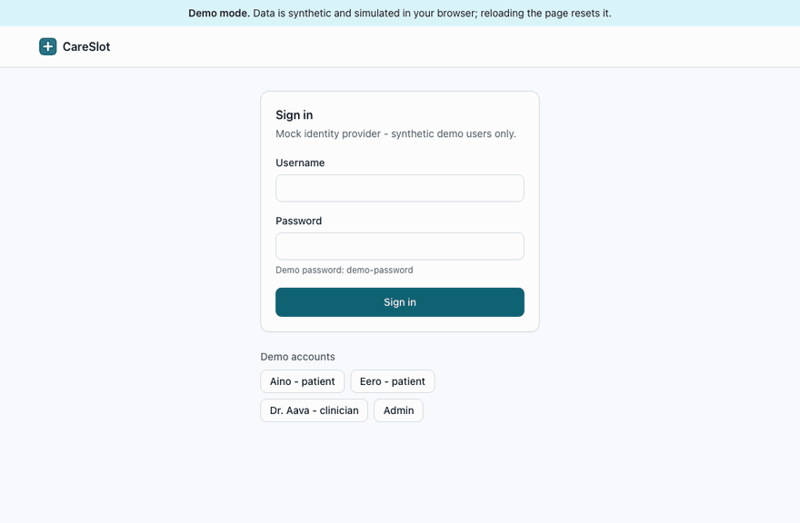
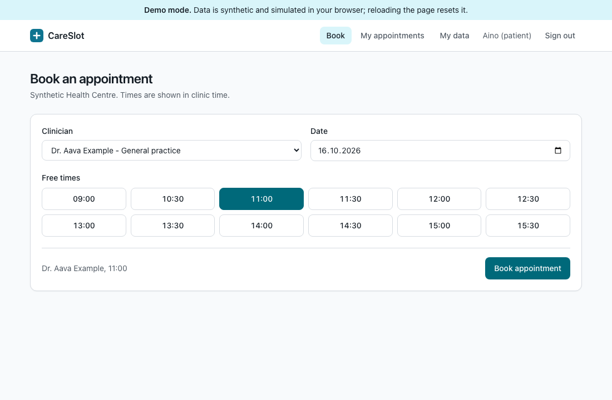
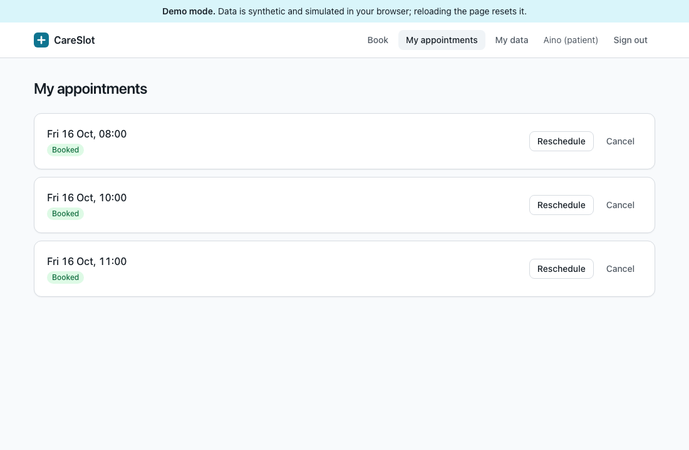
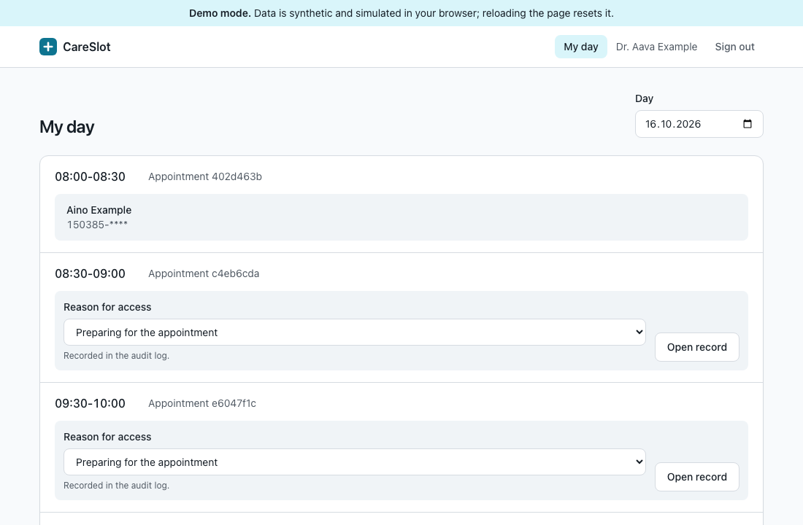
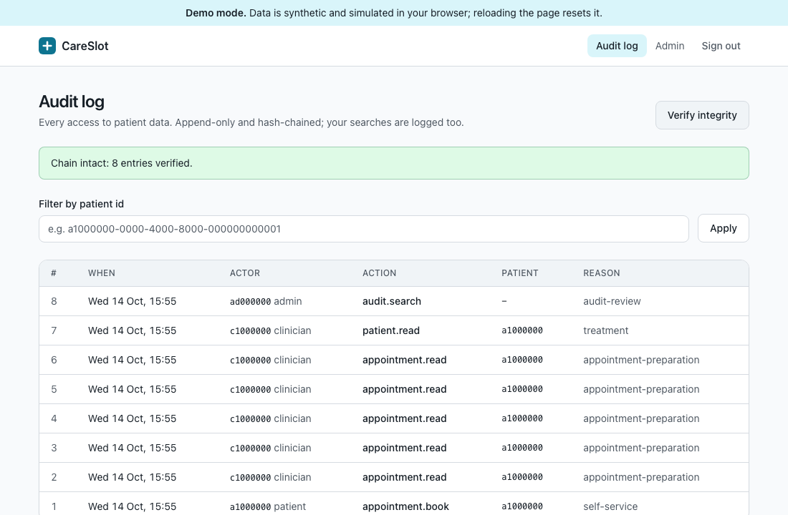
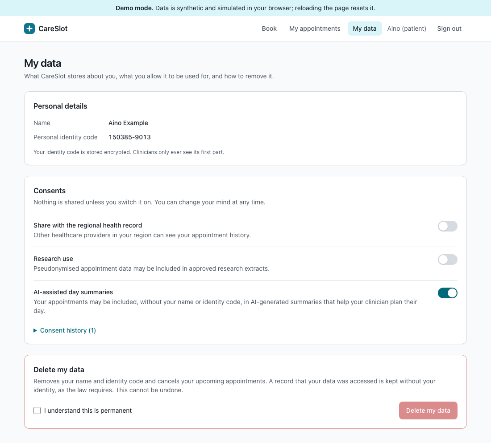
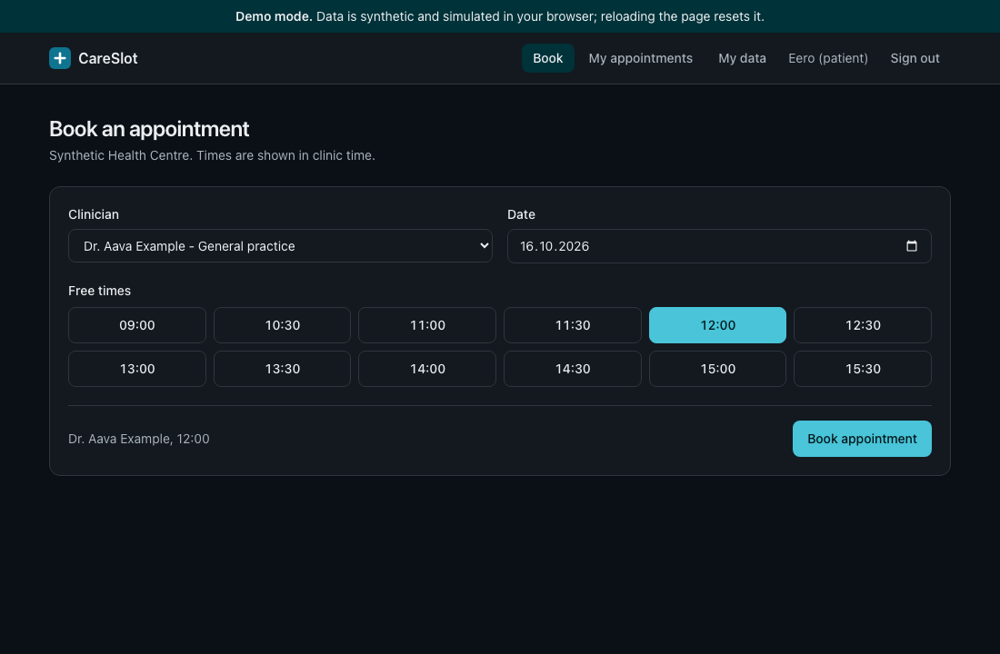
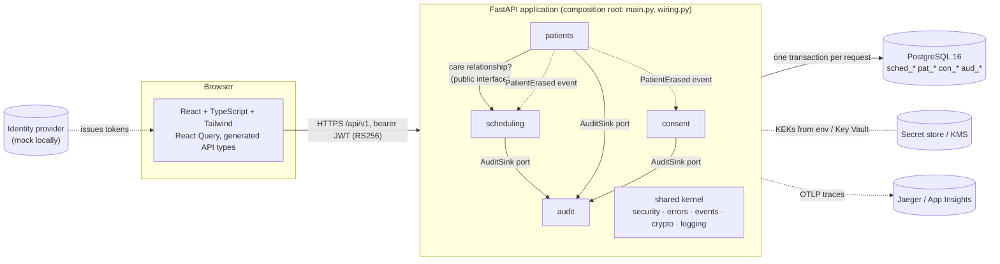

# CareSlot

**Appointment booking and patient consent for healthcare, built to show how a small team can
deliver privacy-critical software quickly and safely, with AI-assisted development under
clear governance.**

> All data in this repository is **synthetic**. Identity codes use the 900–999 range that is
> never issued to real people, and the domain rejects anything else outside production.

**Live client demo:** https://careslot-demo.vercel.app. It is the real UI, with the API
simulated in your browser on synthetic data. Sign in with a demo button; the password is
`demo-password`.



---

## The problem

Patients book, reschedule and cancel appointments; clinicians plan their day; and the
organisation must be able to prove, at any time, **who accessed which patient's data, when and
why**. Consent must be specific, provable and easy to withdraw, and the right to erasure must
work without destroying the audit trail. Getting this wrong is a GDPR incident, so the system
treats privacy and auditability as architecture, not as features added later.

## Screenshots

| Patient: book a time | Patient: my appointments |
|---|---|
|  |  |
| **Clinician: open a record only with a stated reason** | **Admin: hash-chained audit log, verified** |
|  |  |
| **Patient: my data, consent and erasure** | **Dark mode (same semantic tokens)** |
|  |  |

## Architecture

A **modular monolith** ([ADR-0001](docs/adr/0001-modular-monolith.md)): one deployable, one
PostgreSQL database, with bounded-context modules whose boundaries are **enforced in CI**.



### Module map

| Module | Owns | Public interface | Notes |
|---|---|---|---|
| `scheduling` | clinics, clinicians, slots, appointments (`sched_*`) | events (`AppointmentBooked/Rescheduled/Cancelled`), `care_relationship_checker`, `on_patient_erased` | No double booking: a partial unique index is the real guard |
| `patients` | minimal patient identity (`pat_*`) | `PatientErased` | Identity code envelope-encrypted, blind-indexed, masked for clinicians |
| `consent` | consent decision history (`con_*`) | `ConsentGranted/Withdrawn`, `patient_has_consent` | Append-only, versioned, opt-in, strict booleans |
| `audit` | append-only hash-chained log (`aud_*`) | `get_audit_sink`, `make_audit_sink` | Trigger blocks UPDATE/DELETE/TRUNCATE; chain detects tampering |
| `shared` | kernel: config, db, errors, events, security, crypto, logging, observability | n/a | Must not import modules (enforced) |
| `mock_idp` | demo token issuer | n/a | Never mounted in production (tested) |

Each module has `domain/` (pure Python rules), `application/` (use cases and authorisation),
`infrastructure/` (SQLAlchemy) and `api/` (FastAPI). Dependencies point inwards, and modules
use each other only through public interfaces or events
([ADR-0002](docs/adr/0002-in-process-event-bus.md)). Seven import-linter contracts fail the
build otherwise.

## Security and GDPR

| Concern | How | Proof |
|---|---|---|
| Authentication | RS256 JWTs, algorithm pinned, `iss`/`aud`/`exp` required, API holds only the public key; failed-login rate limiting; access token in memory only, sessions survive reloads through an `HttpOnly` refresh cookie ([ADR-0012](docs/adr/0012-session-refresh-cookie.md)) | `tests/unit/test_auth.py` (incl. `alg=none` forgery) |
| Ownership | Patients see only their own data; others' resources return **404, not 403** | negative tests in `test_service.py` |
| Purpose limitation | Clinicians open a record only with a care relationship **and** a stated clinical reason | `test_patients_and_audit.py` |
| Audit | Every successful patient-data access is audited *in the same transaction*; append-only by trigger; SHA-256 hash chain; reading the log is audited ([ADR-0004](docs/adr/0004-append-only-hash-chained-audit-log.md)) | tamper test with the trigger disabled |
| Encryption at rest | Identity code: AES-256-GCM per value, KEK-wrapped data keys, row-bound AAD, HMAC blind index, key rotation by version ([ADR-0003](docs/adr/0003-column-level-envelope-encryption.md)) | `test_crypto.py`, raw-column checks |
| Data minimisation | Patients = id, name, identity code; closed lists instead of free text (e.g. cancellation reasons) | `test_free_text_reasons_are_rejected` |
| Consent | Append-only decision history with notice version; unambiguous booleans ([ADR-0007](docs/adr/0007-consent-as-decision-history.md)) | `test_gdpr.py` |
| Right to erasure | Anonymise patient → `PatientErased` → future bookings cancelled, consent dropped; audit kept and still verifies | `test_right_to_erasure_end_to_end` |
| Retention | `python -m careslot.jobs.retention` deletes booking data 730 days after the visit; audited | `test_retention_job_…` |
| No PII in telemetry | Route-template access logs, trace IDs, key-based redaction, SQL spans without values | `test_observability.py` |
| Web hardening | Strict CSP, nosniff, no-referrer, `no-store` on API responses | `e2e/headers.spec.ts` (nginx and Vercel) |

The STRIDE analysis of the booking flow, with residual risks, is in
**[THREAT_MODEL.md](THREAT_MODEL.md)**.

### Security as a developer: the day-to-day habits

The table above shows what the system does. These are the habits behind it, from the first
commit to merge:

1. **Synthetic data only.** `make seed` creates every patient, clinician and slot. No real
   personal data goes into code, fixtures, test names, screenshots, prompts, commits or PR text.
2. **No secrets in git.** `make up` generates local-only encryption keys into `.env` (which is
   git-ignored). Keys reach the app only through the environment or a secret store, never
   hard-coded and not even in tests (the test fixtures supply them).
3. **Local guardrails before every commit.** The pre-commit hooks run `gitleaks` and
   `detect-private-key` together with ruff, import-boundary checks and frontend lint. A leaked key is
   stopped on your machine and never reaches the remote.
4. **Code rules that close whole bug classes:**
   - Validate every input at the API edge with Pydantic, with lengths and formats constrained.
     Use closed lists instead of free text.
   - Log IDs, never names, identity codes, emails, phone numbers or free text. Key redaction
     in `shared.logging` is only a safety net. On the frontend `no-console` is an ESLint error.
   - Every read or write of patient data goes through the `audit` module, in the same
     transaction.
   - For someone else's record, return **404, not 403**.
   - Modules talk only through their public interface or domain events. `lint-imports`
     enforces this.
   - In the browser the access token is kept in memory only, never in `localStorage`. The refresh token is
     an `HttpOnly` cookie that JavaScript cannot read, and it is sent only to `/auth/*`.
5. **Negative tests for every security rule.** Each rule (ownership, roles, audit, purpose
   limitation) needs a test proving that the forbidden thing really is forbidden.
6. **CI runs the same gates for everyone:** gitleaks over the full history, `pip-audit`,
   `npm audit`, a Trivy container scan (fails on fixable HIGH/CRITICAL), an SBOM, and E2E
   checks of the security headers on both nginx and Vercel. Dependabot keeps dependencies
   current.
7. **Extra review where it matters.** [CODEOWNERS](.github/CODEOWNERS) requires owner review
   for migrations, `shared/crypto.py`, `shared/security.py`, the audit module, `AGENTS.md`
   and the AI policy. Protected branches cannot be pushed to directly.
8. **New dependencies need a reason** in the PR: what the dependency does, why the stdlib or existing deps are not
   enough, its licence and its maintenance status.

More detail: [docs/engineering-standards.md §6](docs/engineering-standards.md) and
[CONTRIBUTING.md](CONTRIBUTING.md).

## AI-assisted development, governed

This repository was built with an AI coding agent working under the same rules it defines:

- **[AGENTS.md](AGENTS.md)** (read automatically by agents; [CLAUDE.md](CLAUDE.md) points to
  it): architecture rules, conventions, testing and security rules, and what agents must
  **never** do (touch migrations without asking, weaken tests, log personal data, add
  unjustified dependencies…).
- **[docs/ai-development-policy.md](docs/ai-development-policy.md)**: approved tools, data that
  must never be pasted into prompts, how AI-generated code is reviewed, and how AI-assisted
  PRs are labelled.
- **[PR template](.github/pull_request_template.md)** with an *AI assistance used?* section and
  a review checklist.
- **The same gates for everyone:** pre-commit hooks and CI apply identically to human and AI
  changes.
- **[docs/ai-metrics.md](docs/ai-metrics.md)**: how to measure the impact (DORA, review time,
  PR size, escaped defects) against a baseline, at team level only.

The gates earned their keep while building this repo. They caught a formatting slip
(leading to pre-commit hooks), five API contract gaps (schemathesis), a lax consent boolean,
41 fixable CVEs in a base image (Trivy), nginx silently dropping every security header, and a
duplicate connection pool that hid SQL from traces. Each became a regression test or a
guardrail.

### How agents work together (A2A)

CareSlot has **no runtime agent-to-agent (A2A) protocol**. No production service delegates
work to another AI agent, and the app exposes no agent endpoints or agent cards. "Agent to
agent" here means how AI agents and people work together *while building* the code:

```
 human (task + approval)
        │
        ▼
 AI coding agent ──reads──▶ AGENTS.md  (shared contract: architecture, security, NEVER-list)
        │                      ▲
        │ may spawn helper     │ same file, same rules
        ▼ agents (search, plan, review)
 helper agents ────────────────┘
        │
        ▼ changes on a branch
 pre-commit hooks ─▶ CI gates ─▶ CODEOWNERS review by a human ─▶ merge
```

- **One shared contract.** Every agent (Claude Code, Copilot, Cursor, and any helper agent one
  of them starts) reads the same [AGENTS.md](AGENTS.md). Agents coordinate through these
  repository rules and the code itself. No private channel between them can skip the rules.
- **Hand-offs go through git, not trust.** An agent hands work to another agent or a human as a
  branch or PR. That work goes through the same hooks and CI as anything else. A helper agent's
  output is treated as untrusted until the gates and a reviewer accept it.
- **A human approves anything that is hard to undo.** Agents may write code, tests and docs.
  Pushing, deploying, publishing, migrations and shell commands outside the project need a
  person, and agents never merge their own PRs.
- **No restricted data passes between agents.** The rule against putting real data, secrets or
  unpatched vulnerability details into a prompt applies to every agent hand-off too
  ([AI policy §2](docs/ai-development-policy.md)).
- **New agent tools are new data flows.** MCP servers, plugins and extra agents need approval
  from the lead developer and security, by a PR to the AI policy.

The planned **AI day-summary assistant** (see *Built vs Planned*) is a single, feature-flagged
call to an LLM, not a multi-agent system. It receives only a pseudonymised, minimised view of
consenting patients, and its output is schema-validated before use. If agent-to-agent
integration is ever added, it gets its own ADR and threat-model entry first.

## Run it

Prerequisites: Docker, Python 3.12, Node 22, [uv](https://docs.astral.sh/uv/), make.

```bash
make install            # dependencies + pre-commit hooks
make up                 # db + api + web (generates local-only encryption keys into .env)
make seed               # synthetic clinic, clinicians, slots and patients
```

- Web: http://localhost:5173. Demo users `aino`, `eero` (patients), `dr.aava` (clinician),
  `admin`; password `demo-password`.
- API docs: http://localhost:8000/api/v1/docs (contract: [`api/openapi.json`](api/openapi.json))
- Traces: `make up-observability` → http://localhost:16686
- Fresh start: `make reset`

## Test it

| Level | Command | What it proves |
|---|---|---|
| Unit | `make test-unit` | Domain rules and authorisation, in milliseconds |
| Integration | `make test-integration` | Real PostgreSQL (Testcontainers) via the real migrations: constraints, triggers, races, encryption at rest |
| Contract | `make test-contract` | Generated requests for every operation conform to the OpenAPI contract |
| E2E | `make e2e` | Browser journeys for all three roles, axe WCAG 2.2 AA scans, security headers |
| Everything | `make check` | What CI runs |

Current suite: **117 backend tests** plus contract tests over all operations, **13 frontend
unit tests**, and **7 Playwright checks**.

**CI** (GitHub Actions): ruff, import boundaries, mypy strict, all backend tests, OpenAPI drift
check, ESLint/Prettier (including Tailwind class order), tsc strict, Vitest, build,
generated-types drift check, E2E on the Compose stack, gitleaks (full history), pip-audit,
npm audit, container build with SPDX SBOM and Trivy scan, and Terraform fmt/validate.

## Contribute

Start with **[docs/onboarding.md](docs/onboarding.md)**: running stack, tour, tests and a
first feature on day one. Then read [CONTRIBUTING.md](CONTRIBUTING.md) and
[docs/engineering-standards.md](docs/engineering-standards.md) (branching, commits, definition
of done, test pyramid, review culture). A fully worked feature, layer by layer:
[docs/example-feature-walkthrough.md](docs/example-feature-walkthrough.md).

| Docs | |
|---|---|
| [Architecture decisions (10 ADRs)](docs/adr/README.md) | [Non-functional requirements: SLOs, scaling, caching, DR, cost](docs/non-functional-requirements.md) |
| [Threat model (STRIDE)](THREAT_MODEL.md) | [Infrastructure (Terraform)](infra/terraform/README.md) |

## Tech stack

**Backend:** Python 3.12, FastAPI, Pydantic v2, SQLAlchemy 2, Alembic, PostgreSQL 16,
structlog, OpenTelemetry, uv. **Frontend:** React 19, TypeScript (strict), Vite,
Tailwind CSS v4 (semantic tokens, `cva` + `cn()`), React Query, React Router, MSW for the demo.
**Quality:** pytest, Testcontainers, schemathesis, Vitest, Playwright + axe, Ruff, mypy,
import-linter, ESLint (jsx-a11y strict), Prettier. **Infra:** Docker Compose, Terraform (Azure,
cloud-neutral module interfaces), GitHub Actions, Vercel (demo).

## Built vs Planned

Only things that are implemented **and** tested are listed as built.

| Capability | Status |
|---|---|
| Booking, rescheduling, cancelling (with optional reason) and clinician day view | ✅ Built |
| Double-booking prevention under concurrency (DB constraint, race-tested) | ✅ Built |
| JWT auth (RS256), roles, ownership, 404-not-403, login rate limiting, mock IdP | ✅ Built |
| Append-only, hash-chained audit log with admin search and verification | ✅ Built |
| Envelope encryption + blind index for identity codes, key rotation by version | ✅ Built |
| Consent history, right to erasure (event fan-out), retention job | ✅ Built |
| Modular monolith with CI-enforced boundaries; in-process event bus | ✅ Built |
| OpenAPI contract (committed, drift-checked), problem+json errors, contract tests | ✅ Built |
| Structured logs without PII, OpenTelemetry traces incl. SQL, `/health` and `/ready` | ✅ Built |
| CI: lint, types, tests, E2E, secret/dependency/container scanning, SBOM, Terraform validate | ✅ Built |
| Accessible UI (WCAG 2.2 AA scans), light/dark mode, client demo on Vercel | ✅ Built |
| AI governance: AGENTS.md, AI policy, PR template, metrics; 10 ADRs, threat model, onboarding | ✅ Built |
| **AI day-summary assistant** (pseudonymised input, mock LLM, schema-validated output, feature flag) | 🟡 Planned: design noted in the threat model and NFRs; ADR-0008 lands with the implementation |
| Real identity provider (OIDC / Suomi.fi) and IdP deactivation on erasure | 🟡 Planned |
| Terraform applied to a real subscription; deploy pipeline | 🟡 Planned (skeleton validates) |
| Transactional outbox + message broker for events | 🟡 Planned ([ADR-0002](docs/adr/0002-in-process-event-bus.md)) |
| Gateway/Redis rate limiting, security-event stream for denied access, scheduled audit-chain verification with WORM anchoring | 🟡 Planned ([THREAT_MODEL.md](THREAT_MODEL.md)) |
