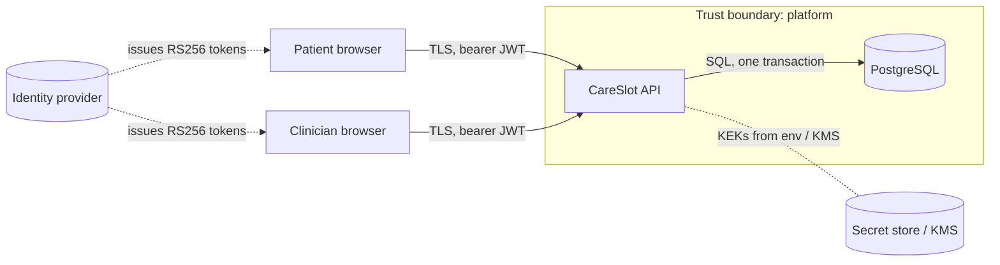

# Threat model: booking flow (STRIDE)

**Scope:** a patient signs in, searches free slots, books, reschedules or cancels; a clinician
views the day and opens a patient record; an admin reviews the audit log.
**Assets:** patient identity (name, personal identity code), appointment data (which is health
data: *who* sees a physiotherapist *when*), the audit trail, signing and encryption keys.
**Last reviewed:** 2026-10-14. Review on every change to auth, data model or trust boundaries.

Each mitigation names the code or test that implements it.

| STRIDE | Threat | Mitigation | Where |
|---|---|---|---|
| **S**poofing | Forged or tampered token | RS256 only (algorithm pinned, `alg=none` rejected); `iss`/`aud`/`exp`/`sub` required; API holds only the public key | `shared/security.py`, `tests/unit/test_auth.py` |
| | Password guessing on login | 5 *failed* attempts/min per client+username → 429 with `Retry-After`; constant-time compare; KDF runs for unknown users too | `mock_idp/router.py`, `shared/ratelimit.py` |
| | Stolen token reused | 15-min access token kept in memory only (not localStorage); the reload-surviving refresh token is in an `HttpOnly`, `Secure`, `SameSite=Strict` cookie scoped to `/api/v1/auth`, lasts at most 8 h and ends with the browser session (ADR-0012) | `shared/security.py`, `mock_idp/router.py`, `frontend/src/api/client.ts` |
| | Refresh token replayed as an access token | Refresh token is addressed to the IdP (`aud` = issuer, `typ=refresh`); the API only accepts its own audience | `test_refresh_token_is_not_accepted_as_an_access_token` |
| | CSRF against the refresh cookie | `SameSite=Strict`; refresh only returns JSON, which CORS (explicit origin list) hides from other origins; no state-changing endpoint reads the cookie except logout | `mock_idp/router.py`, `main.py` |
| **T**ampering | Booking on someone else's behalf (mass assignment) | Patient id taken from the token, never the body; `extra="forbid"` rejects unknown fields | `scheduling/application/services.py`, `test_unknown_fields_are_rejected` |
| | Race: two patients book the same slot | Partial unique index (one *booked* appointment per slot) as the final guard | `scheduling/infrastructure/models.py`, `test_concurrent_bookings_cannot_both_win` |
| | Editing or deleting audit history | DB trigger blocks UPDATE/DELETE/TRUNCATE; SHA-256 hash chain detects tampering by privileged users | migration `ed9f2c4c9a5c`, `test_tampering_by_a_privileged_db_user_is_detected` |
| | Swapping encrypted values between rows | AES-GCM with row-bound AAD | `shared/crypto.py`, `test_ciphertext_moved_to_another_row_fails` |
| **R**epudiation | "I never opened that record" | Every successful patient-data access is audited *in the same transaction*, with actor, action, resource, time and purpose; clinicians must state a purpose | `shared/audit.py`, `test_clinician_access_requires_relationship_and_is_audited_with_reason` |
| | Admin covers tracks | Searching the audit log is itself audited | `audit/application/services.py` |
| **I**nformation disclosure | Patient enumerates others' appointments (IDOR) | Ownership checks in use cases; **404 instead of 403** for others' resources | `test_patient_cannot_see_another_patients_appointment` |
| | Clinician browses arbitrary patients | Requires a care relationship *and* a clinical reason; masked identity code only | `patients/application/services.py` |
| | DB dump or backup leak | Identity code envelope-encrypted; keys outside the DB | ADR-0003 |
| | Personal data in logs or traces | No PII logged by rule; key-based redaction as safety net; access log uses route templates, no query strings; SQL spans have placeholders only | `shared/logging.py`, `test_observability.py` |
| | Personal data sent to an LLM | *Planned assistant:* receives only a pseudonymised, minimised view of consenting patients; output schema-validated | ADR-0008 (planned) |
| | Responses cached by proxies or browser | `Cache-Control: no-store` on every API response | `shared/http.py` |
| **D**enial of service | Unbounded slot search | Search window capped at 31 days | `available_slots` |
| | Login flooding | Rate limiting (per replica; gateway/WAF in production) | `shared/ratelimit.py` |
| **E**levation of privilege | Patient calls clinician or admin endpoints | Role check at the route *and* in the use case | `require_role`, `_require` |
| | Mock IdP reachable in production | Not mounted when `environment=production`; startup fails without a real public key | `test_mock_idp_is_not_mounted_in_production` |
| | XSS steals tokens | Strict CSP (`script-src 'self'`), React escaping, no `dangerouslySetInnerHTML`; headers asserted by E2E; refresh cookie is `HttpOnly`, so script cannot read it | `frontend/security-headers.conf`, `e2e/headers.spec.ts`, `e2e/session.spec.ts` |

## Residual risks and planned work

- **Rate limiting is per replica.** Move it to the API gateway/WAF or Redis before scaling out.
- **Denied access attempts are not in the audit log** (the request rolls back). They should go
  to a separate security-event stream for SIEM alerting.
- **No IdP deactivation on erasure.** The real IdP integration should consume `PatientErased`.
- **Mock refresh tokens cannot be revoked.** They are stateless, so logout clears the cookie but
  a copy taken elsewhere works for up to 8 hours. A real IdP keeps revocable server-side sessions.
- **Audit chain verification is O(n)** and on demand. Schedule it, and anchor chain heads to
  WORM storage (ADR-0004).
- **No WAF, DDoS protection or bot management** in this repository. These are platform concerns,
  covered in the Terraform notes.

AI-specific risks (coding agents and the planned assistant, mapped to the OWASP Top 10 for LLM
Applications) are tracked in [docs/ai-risks.md](docs/ai-risks.md). Report vulnerabilities as
described in [SECURITY.md](SECURITY.md).
